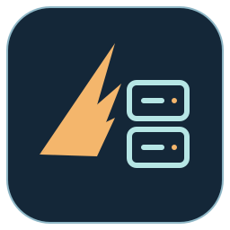

<p align="center">
  
</p>

<h1 align="center">icarus-bevy</h1>

<p align="center"><strong>Independent native Linux dedicated-server research in Rust and Bevy.</strong></p>

<p align="center">
  <a href="https://github.com/edbfi/icarus-bevy/blob/main/LICENSE">
    
  </a>
  <a href="https://github.com/bevyengine/bevy" title="Bevy engine source">
    
  </a>
  <a href="https://github.com/rust-lang/rust" title="Rust language source">
    
  </a>
  <a href="https://git.kernel.org/pub/scm/linux/kernel/git/torvalds/linux.git/" title="Linux kernel source">
    
  </a>
</p>

**This currently runs a headless foundation, not an ICARUS-compatible server.**
Networking, authentication, gameplay, original-world compatibility and
official-save import remain unimplemented and unvalidated. Offline research has resumed; current results and remaining gates are in the
[checkpoint](docs/implementation-status.md#summary).

## Quick start

Requires native Linux, Git, Python 3.15 and Rust 1.100.0 (pinned with Rustfmt and Clippy). Bevy
0.20.1 runs headless; no GPU, display, original game files or Proton are needed.

```bash
python3 tools/cargo_guard.py build --release --locked
python3 tools/cargo_guard.py --hold-target -- target/release/icarus-server check-config --config config/server.example.toml
python3 tools/cargo_guard.py --hold-target -- target/release/icarus-server run --data-dir work/smoke-world --max-ticks 10
```

The [native server runbook](docs/runbooks/native-server.md) covers configuration,
persistence, recovery and save inspection.

**Experimental data inputs:** protocol row identities come from the free
official dedicated server (Steam app 2089300). Gameplay values must be
independently authored in `network.authored_gameplay`; packaged gameplay
tables are not runtime inputs. Run
`icarus-server install-official-data --data-dir DIR` once (and after official
updates): it downloads those files anonymously from Steam without steamcmd or
prompts. Nothing original is bundled with this repository.

## Documentation

| Read | For |
| --- | --- |
| [docs/README.md](docs/README.md) | map of every document and its rules |
| [Plan](docs/linux-dedicated-server-plan.md) | goal, constraints, milestones, release targets |
| [Status](docs/implementation-status.md) | summary, milestone state, next tasks |
| [Gates](docs/gates.md) | preconditions that block actions |
| [Ledgers](docs/ledgers/) | findings by area, unknowns, bugs, compatibility matrix |
| [Specs](docs/specs/) | save-format and network facts |
| [Research](docs/research/) | one digest per question cluster |
| [Runbooks](docs/runbooks/) | server, synthetic workload, original-server launcher, REA tooling, research helpers |

## Contributing

```bash
prek install
prek run --all-files --hook-stage manual
```

Rules for agents and people are in [`.agents/rules/`](.agents/rules/): project
workflow in `project.md`, documentation in `docs.md`. Rust checks use `--locked`;
Python helpers pass basedpyright in recommended mode; commits are signed-off
Conventional Commits on feature branches. CI runs the same hooks plus a release
build and headless smoke test with authored fixtures only.

Original files stay under ignored `icarus-orig/`, supplied saves under ignored
`reference-data/`, and generated analysis under ignored `work/`. No original
assets are extracted or reused. Historical research approvals are indexed in
[docs/history](docs/history/authorizations-index.md); none extends a runtime window.

Original code authored for this project by edbfi is licensed under the
[GNU Affero General Public License](LICENSE), version 3 or (at your option) any
later version (`AGPL-3.0-or-later`). Third-party dependencies, vendored tools and
copied skills retain their own licenses and notices, including the
[MIT-licensed reverse-engineer-anything skill](.agents/skills/reverse-engineer-anything/LICENSE).
