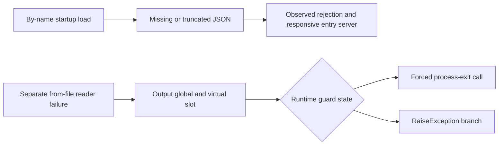

> Archived research report, retained verbatim. Current conclusions live in [the ledgers](../../ledgers/findings.md). Moved from `docs/research/` on 2026-10-13.

# From-file load failure reaches a fatal-output facility

Historical report — 2026-10-04. The observations below retain their static scope.
See the [current checkpoint](../../implementation-status.md) and
[bug ledger](../../bug-ledger.md) for later findings and unresolved validation gates.

The previously unresolved output target is now statically identified for original
tool build **25621760**. The separate from-file failure path reaches an output
implementation with **forced process termination and exception branches**. This is
a stronger lead than an ordinary error log, but the path has **not been reproduced
at runtime** and is not yet a confirmed original-server bug.

## Resolved call chain

| Preferred address | Observed role |
| --- | --- |
| `0x1414baf60` | From-file loader; staged-reader failure enters the reporting helper |
| `0x141ee8930` | Reads output global `0x146210ce0`, sets an error flag and forwards formatted text |
| `0x1408a30f5` / `0x1408a30fa` | Initialization obtains the output object and stores it in that global |
| `0x1421c8740` | Returns static object `0x146278108`, assigning virtual table `0x144f09e00` |
| `0x141f31140` | Formats text and dispatches through output virtual slot `+0x10` |
| `0x141f72ad0` | That slot's target; tests error/guard state and chooses termination or exception handling |
| `0x141f829f0` → `0x141f82ab0` | Forced-exit request tail-calls the status form; forced branch reaches imported `GetCurrentProcess` and `TerminateProcess` |
| `0x141f70fe0` / `0x141f72120` | Alternate branches call imported `RaiseException` with `0x4000` or `0x8000` |

The virtual output method calls the exit helper with its force argument set.
The request helper's non-forced alternative posts a quit message, but that is not
the argument observed at this call site. Exception handling depends on runtime
guard state; the exception codes alone do not establish the final process outcome.
The initializer search found one direct store; indirect reassignment elsewhere
has not been exhaustively excluded.

## Evidence and limitation

Private evidence is in `work/icarus-overnight/static/failure-output-*`,
`static/failure-terminal-*`, `decompile-08/` and `decompile-09/`, with command
arguments and helper hashes in the case journal. The earlier from-file branch
is recorded by baseline E-010/E-016/E-020. Instruction-level checks confirm the
indirect output slot, force argument and imported termination call; decompiler
types and global names remain provisional.

The RequestExit decompilation follows a tail jump into a distinct status routine.
It must not be treated as a single function's unwind range. The bounded companion
disassembly confirms this boundary and the complete `TerminateProcess` jump;
its trailing partially decoded PostQuitMessage instruction is not used as evidence.

The [runtime by-name rejection cases](2026-10-04-prospect-rejection.md) exercise a
different route and do not contradict this lead. A controlled valid prospect and
a demonstrated transition into the `LocalSavePath` caller are still needed to
test failure timing, process outcome and world-state preservation. Guessing a map
or bypassing admission would not establish that behavior.

For the independent replacement, recoverable external-file errors should remain
typed load failures, leaving source bytes and the current world intact. Existing
read-only envelope inspection follows that policy; official world import remains
unavailable. This design requirement is not a claim to have fixed the original.
